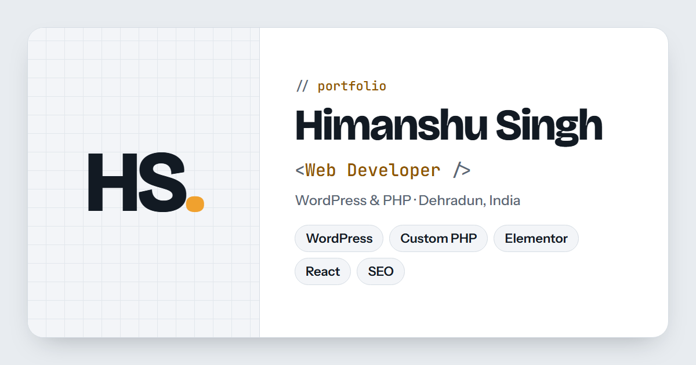

# Himanshu Singh: Portfolio

**Live site: [himanshupharswan.github.io/Himanshu-Singh-Portfolio](https://himanshupharswan.github.io/Himanshu-Singh-Portfolio/)**

My personal portfolio. I'm a web developer in Dehradun, India, working mainly with WordPress and custom PHP, plus React integrations and automation with n8n and GoHighLevel.

## What's on the site

- **About:** who I am and what I do
- **Resume:** experience, internships, skills and education, with a downloadable CV
- **Work:** live client websites and projects, filterable by WordPress, custom themes, integrations and automation
- **Contact:** email, LinkedIn and WhatsApp

## Built with

Plain HTML, CSS and JavaScript, with no framework and no build step. It's hosted on GitHub Pages.

- Light and dark themes
- Responsive layout for phones, tablets and desktops
- Project filters, copy-to-clipboard buttons and a floating WhatsApp button on phones
- WebP images with JPG fallbacks

## Run it locally

Clone the repository and open `index.html` in a browser. There's nothing to install.

The full editing guide (images, resume, projects, colours, hosting) is in [docs/GUIDE.md](docs/GUIDE.md).

## Contact

[LinkedIn](https://www.linkedin.com/in/himanshu-singh-web-developer/) · [Email](mailto:himanshupharswan67@gmail.com)
